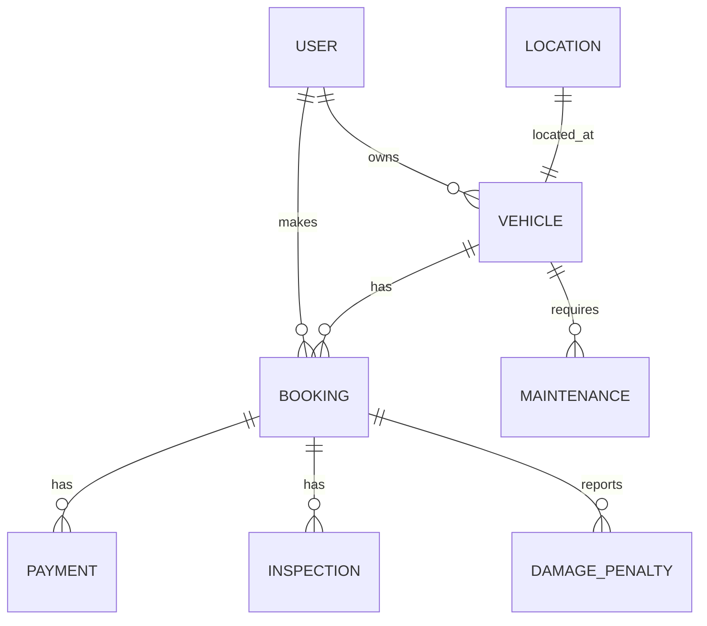

# Peer-to-Peer Tourist Bike Rental Management System
> **Phase 1: Database Architecture, Business Rules & Backend API**

A database-driven platform connecting local bike owners with tourists, implementing an 8-entity relational model, business constraint validations, and complete lifecycle transaction workflows.

---

## 🚀 Quick Start for Presentation / Viva Tomorrow

You have one-click launcher scripts ready in the root directory:

| Script | What It Does | URL |
|---|---|---|
| **`run_all.bat`** | **Complete Showcase**: Automatically starts both the FastAPI backend and Vite React dashboard in separate windows! | [http://localhost:5173](http://localhost:5173) |
| **`run_frontend.bat`** | Launches the modern React web dashboard. | [http://localhost:5173](http://localhost:5173) |
| **`run_backend.bat`** | Starts the FastAPI server and interactive Swagger UI. | [http://127.0.0.1:8000/docs](http://127.0.0.1:8000/docs) |
| **`run_demo.bat`** | Launches the terminal-based scenario demonstrator (Scenarios 9.1–9.12). | Terminal CLI |

---

## 🗄️ Database Architecture (8 Relational Entities)

The schema strictly reflects the Chen ER and UML class diagrams from the DBMS report:

### Table Definitions & Keys

1. **`LOCATION`**: `location_id` (PK), `address`, `city`, `state`, `pincode`, `pickup_instructions`.
2. **`USER`**: `user_id` (PK), `name`, `email`, `phone`, `password`, `role` (`Tourist` / `Owner` / `Admin`), `verification_status` (`Pending` / `Verified` / `Rejected`), `account_status` (`Active` / `Inactive` / `Suspended`), `created_at`.
3. **`VEHICLE`**: `vehicle_id` (PK), `owner_id` (FK → USER), `location_id` (FK → LOCATION), `vehicle_number` (UNIQUE), `vehicle_type`, `brand`, `model`, `year`, `rental_rate_per_day`, `security_deposit`, `vehicle_status` (`Available` / `Booked` / `Under Maintenance` / `Inactive`).
4. **`BOOKING`**: `booking_id` (PK), `tourist_id` (FK → USER), `vehicle_id` (FK → VEHICLE), `start_date`, `end_date`, `booking_date`, `rental_amount`, `booking_status` (`Pending` / `Approved` / `Rejected` / `Cancelled` / `Completed`), `cancellation_reason`.
5. **`PAYMENT`**: `payment_id` (PK), `booking_id` (FK → BOOKING), `amount`, `payment_type` (`Rental` / `Deposit` / `Refund` / `Penalty`), `payment_status`, `transaction_reference` (UNIQUE), `commission_amount`, `owner_earning`.
6. **`INSPECTION`**: `inspection_id` (PK), `booking_id` (FK → BOOKING), `inspection_type` (`Pickup` / `Return`), `inspection_date`, `vehicle_condition`, `fuel_status` (`Full` / `Half` / `Reserve`), `notes`.
7. **`DAMAGE_PENALTY`**: `incident_id` (PK), `booking_id` (FK → BOOKING), `incident_type` (`Damage` / `Late Return` / `Other`), `description`, `amount`, `reported_date`, `resolution_status` (`Under review` / `Upheld` / `Waived` / `Resolved`).
8. **`MAINTENANCE`**: `maintenance_id` (PK), `vehicle_id` (FK → VEHICLE), `maintenance_type`, `description`, `maintenance_date`, `cost`, `status` (`In Progress` / `Completed`).

---

## 📋 The 12 Real-World Scenarios Implemented & Verified

| Scenario | Title | Key Business Rule Validated |
|---|---|---|
| **9.1** | Successful End-to-End Booking | Complete lifecycle: Request → Approval → Payment (10% commission split) → Pickup inspection → Return inspection → Status Completed. |
| **9.2** | Owner Rejects Booking | Status changes to Rejected; no payment row is generated; vehicle remains Available for other tourists. |
| **9.3** | Overlap Booking Prevention | Interval intersection check `(start1 <= end2) AND (end1 >= start2)` blocks or auto-rejects overlapping requests. |
| **9.4** | Damage Reported After Return | Condition marked Damaged in return inspection; `DAMAGE_PENALTY` incident row logged for repair cost. |
| **9.5** | Vehicle Blocked Under Maintenance | Starting maintenance sets status to `Under Maintenance`, blocking all booking attempts until marked `Completed`. |
| **9.6** | Pre-Pickup Cancellation | Status updated to `Cancelled`, refund transaction recorded in `PAYMENT`, vehicle restored to `Available`. |
| **9.7** | Late Return Penalty | Extra hours logged as an incident in `DAMAGE_PENALTY`, resolved against security deposit. |
| **9.8** | One Tourist, Multiple Bookings | Demonstrates 1:N cardinality between `USER` and `BOOKING` across different cities (Manali & Shimla). |
| **9.9** | One Owner, Multiple Vehicles | Demonstrates 1:N cardinality between `USER` and `VEHICLE` with independent statuses and locations. |
| **9.10** | Admin Verifies New User | Unverified owner (`Pending`/`Inactive`) is blocked from listing vehicles until Admin KYC approval. |
| **9.11** | Admin Resolves Disputed Incident | Admin compares pickup vs return inspection condition reports to resolve dispute (`Waived` vs `Upheld`). |
| **9.12** | Fuel Handover (No Odometer) | Renter is responsible for fuel after initial handover; zero odometer or fuel ledger pollution in DB schema. |

---

## 🎯 Viva / Presentation Cheat Sheet

### Q1: Why use 8 entities instead of separate tables for Tourist, Owner, and Admin?
> **Answer**: All three roles share fundamental attributes (name, email, phone, password, verification status). Using a single `USER` table with a `role` discriminator keeps the schema unified, avoids redundant tables, and simplifies authentication while allowing a person to act in different roles without duplicate profiles.

### Q2: How does the system prevent double-booking for the same bike?
> **Answer**: The system enforces temporal interval logic. Before approving or creating a booking, the query verifies:
> `WHERE vehicle_id = ? AND booking_status = 'Approved' AND start_date <= ? AND end_date >= ?`.
> If any row is returned, the new request is blocked or marked Rejected.

### Q3: Why is there no odometer reading or fuel calculation table?
> **Answer**: Per the business rule in Section 3.1, the owner provides sufficient fuel to reach the nearest fuel station, after which fuel is the tourist's operational responsibility. Removing odometer tracking eliminates unnecessary columns, calculation complexity, and fuel dispute overhead while preserving real-world viability.

### Q4: How is financial safety maintained?
> **Answer**: `PAYMENT` tracks every financial event (`Rental`, `Deposit`, `Refund`, `Penalty`) linked back to a `booking_id`. Platform commission (e.g. 10%) and owner net earnings (90%) are tracked explicitly.
