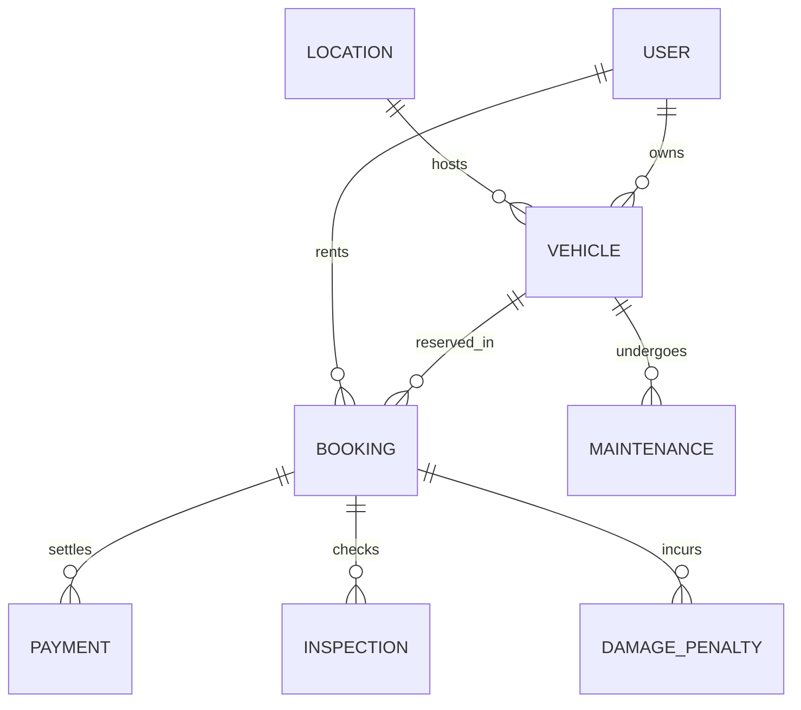

# Peer-to-Peer Tourist Bike Rental Management System
## Final DBMS Laboratory Assessment Report (Review 1, 2 & 3 Complete)

---

## 1. Executive Summary & Problem Definition

* **Domain:** Peer-to-Peer Tourist Two-Wheeler Rental & Fleet Management.
* **Problem Statement:** Traditional bike rentals in tourist destinations (e.g., Manali, Shimla) suffer from double bookings, opaque fuel handovers, unverified owners, arbitrary damage penalty disputes, and delayed payouts. 
* **Solution:** A centralized relational database-driven web application with strict constraints, automated business logic via triggers/stored procedures, transparent audit logs, role-based access control, and transaction integrity.

---

## 2. Requirement Analysis & Evaluation Breakdown

### Requirement 1: Entity-Relationship (ER) Model
* **Tool:** [dbdiagram.io](https://dbdiagram.io) code provided in `docs/dbdiagram_er.dbml`.
* **Entities (8 total):**
  1. `LOCATION` (Pickup/Drop hubs)
  2. `USER` (Tourists, Owners, Central Admin)
  3. `VEHICLE` (Scooters, Cruisers, Motorcycles)
  4. `BOOKING` (Rental date ranges and status)
  5. `PAYMENT` (Ledger of rentals, deposits, refunds, penalties)
  6. `INSPECTION` (Pickup and return condition logs)
  7. `DAMAGE_PENALTY` (Incident dispute tracking)
  8. `MAINTENANCE` (Vehicle service logs & lockouts)



#### Cardinalities:
* `LOCATION` to `VEHICLE`: 1 : N (One location stores many vehicles)
* `USER` (Owner) to `VEHICLE`: 1 : N (One owner lists many vehicles)
* `USER` (Tourist) to `BOOKING`: 1 : N (One tourist books many rentals over time)
* `VEHICLE` to `BOOKING`: 1 : N (One vehicle booked across multiple distinct time slots)
* `BOOKING` to `PAYMENT`: 1 : N (One booking can have rental payment, deposit refund, penalty fee)
* `BOOKING` to `INSPECTION`: 1 : N (Each booking has up to 2 inspections: Pickup & Return)
* `BOOKING` to `DAMAGE_PENALTY`: 1 : N (Zero or more damage incidents logged)
* `VEHICLE` to `MAINTENANCE`: 1 : N (Zero or more maintenance records)

---

### Requirement 2: Relational Schema & Key Mapping

1. **LOCATION**
   * **Primary Key:** `location_id`
   * **Attributes:** `address`, `city`, `state`, `pincode`, `pickup_instructions`
2. **USER**
   * **Primary Key:** `user_id`
   * **Candidate Key / Unique:** `email`
   * **Attributes:** `name`, `phone`, `password`, `role`, `verification_status`, `account_status`, `created_at`
3. **VEHICLE**
   * **Primary Key:** `vehicle_id`
   * **Candidate Key / Unique:** `vehicle_number` (license plate)
   * **Foreign Keys:** `owner_id` -> `USER(user_id)`, `location_id` -> `LOCATION(location_id)`
   * **Attributes:** `brand`, `model`, `year`, `rental_rate_per_day`, `security_deposit`, `vehicle_status`
4. **BOOKING**
   * **Primary Key:** `booking_id`
   * **Foreign Keys:** `tourist_id` -> `USER(user_id)`, `vehicle_id` -> `VEHICLE(vehicle_id)`
   * **Attributes:** `start_date`, `end_date`, `rental_amount`, `booking_status`, `cancellation_reason`, `booking_date`
5. **PAYMENT**
   * **Primary Key:** `payment_id`
   * **Candidate Key / Unique:** `transaction_reference`
   * **Foreign Key:** `booking_id` -> `BOOKING(booking_id)`
   * **Attributes:** `amount`, `payment_type`, `payment_status`, `commission_amount`, `owner_earning`, `payment_date`
6. **INSPECTION**
   * **Primary Key:** `inspection_id`
   * **Foreign Key:** `booking_id` -> `BOOKING(booking_id)`
   * **Attributes:** `inspection_type`, `inspection_date`, `vehicle_condition`, `fuel_status`, `notes`
7. **DAMAGE_PENALTY**
   * **Primary Key:** `incident_id`
   * **Foreign Key:** `booking_id` -> `BOOKING(booking_id)`
   * **Attributes:** `incident_type`, `description`, `amount`, `reported_date`, `resolution_status`
8. **MAINTENANCE**
   * **Primary Key:** `maintenance_id`
   * **Foreign Key:** `vehicle_id` -> `VEHICLE(vehicle_id)`
   * **Attributes:** `maintenance_type`, `description`, `maintenance_date`, `cost`, `status`

---

### Requirement 3: Normalization (Up to BCNF)

* **1NF (First Normal Form):**
  * All attributes contain atomic, scalar values (no repeating groups, multi-valued attributes, or comma-separated lists).
  * Every table has a clearly defined primary key.
* **2NF (Second Normal Form):**
  * Meets 1NF.
  * All non-key attributes are fully functionally dependent on the entire primary key (no partial dependencies on composite keys). All primary keys are single-attribute identifiers (`user_id`, `vehicle_id`, etc.).
* **3NF (Third Normal Form):**
  * Meets 2NF.
  * No transitive dependencies exist (X -> Y and Y -> Z where Z is non-prime).
  * Example: Owner name and phone are stored exclusively in `USER`, not duplicated in `VEHICLE` or `BOOKING`. Location city and address are stored in `LOCATION`, referenced by `location_id`.
* **BCNF (Boyce-Codd Normal Form):**
  * For every functional dependency X -> Y, X is a superkey.
  * In `USER`, `email` is unique and satisfies superkey requirements.
  * In `VEHICLE`, `vehicle_number` is unique and is also a superkey.
  * Hence, the entire relational schema is in **BCNF**.

---

### Requirement 4: Sample Queries
Located in `backend/sql/sample_queries.sql`:
* **DDL:** Table creation with `CHECK` constraints, foreign keys with cascade policies, and auto-increment audit tables.
* **DML:** `INSERT`, conditional `UPDATE`, and time-windowed `DELETE`.
* **SQL Functions:** Date difference (`julianday` / `DATEDIFF`), string concatenation, `strftime` formatting.
* **Joins & Subqueries:** 5-table relational joins, non-correlated subqueries (`AVG` spenders), and correlated `NOT EXISTS` damage checks.
* **Aggregations:** `GROUP BY` and `HAVING` computing fleet volume, platform commission, and average rate per city.

---

### Requirement 5: Advanced Database Features

#### a. 2 Database Views:
1. `VIEW_ACTIVE_RENTALS`: Aggregates ongoing rentals with live tourist contact info, vehicle details, and pickup instructions.
2. `VIEW_OWNER_REVENUE_SUMMARY`: Computes each owner's fleet size, booking volume, gross earnings, and net 90% payouts after platform commission.

#### b. 2 Stored Procedures (MySQL):
1. `sp_process_rental_payment`: Atomically validates booking state, applies a 10% platform commission calculation, writes the payment record, and updates vehicle status to `Booked`.
2. `sp_create_booking_request`: Checks owner KYC verification, prevents scheduling during active vehicle maintenance, verifies no overlapping approved bookings exist, and records the pending booking.

#### c. 1 Stored Function (MySQL):
* `fn_calculate_rental_cost(p_vehicle_id, p_start_date, p_end_date)`: Computes total rental bill by multiplying daily rate by the inclusive date span (D2 - D1 + 1).

#### d. 2 Triggers:
1. `trg_payment_update_vehicle_booked`: Fires `AFTER INSERT ON PAYMENT` (when `payment_type = 'Rental'` and `payment_status = 'Success'`) to immediately lock the vehicle into `Booked` status.
2. `trg_inspection_complete_booking`: Fires `AFTER INSERT ON INSPECTION` (when `inspection_type = 'Return'`) to mark `BOOKING` as `Completed` and restore `VEHICLE` to `Available`.

#### e. Indexes & Justification:
* `idx_vehicle_owner (owner_id)`: Speeds up fleet queries by owner.
* `idx_vehicle_status (vehicle_status)`: Accelerates city-level availability browsing.
* `idx_booking_vehicle (vehicle_id, booking_status)`: Optimizes overlap conflict checks in O(log n).
* `idx_booking_tourist (tourist_id)`: Enables instant retrieval of user booking histories.
* `idx_payment_booking (booking_id)`: Accelerates payment status lookups and refund joins.

---

### Requirement 6: Transaction Management & ACID Implementation

#### Demonstrated Real-World Transaction:
**Return Settlement & Penalty Assessment Transaction:**
```sql
START TRANSACTION;
-- 1. Insert Return Inspection
INSERT INTO INSPECTION (inspection_id, booking_id, inspection_type, vehicle_condition, fuel_status)
VALUES ('I901', 'B101', 'Return', 'Scratched exhaust pipe', 'Full');

-- 2. Create Savepoint before dispute evaluation
SAVEPOINT before_penalty;

-- 3. Assess damage penalty
INSERT INTO DAMAGE_PENALTY (incident_id, booking_id, incident_type, description, amount, resolution_status)
VALUES ('D801', 'B101', 'Damage', 'Exhaust damage', 300.00, 'Upheld');

-- If review shows damage existed at pickup:
-- ROLLBACK TO SAVEPOINT before_penalty;

-- 4. Refund remaining security deposit
INSERT INTO PAYMENT (payment_id, booking_id, amount, payment_type, payment_status, transaction_reference)
VALUES ('P902', 'B101', 700.00, 'Refund', 'Success', 'TXN-REFUND-902');

-- 5. Commit changes atomically
COMMIT;
```

#### Application of ACID Properties:
* **Atomicity:** The payment record, vehicle status update, and owner payout calculation succeed together or rollback completely. A payment is never recorded without updating the booking and vehicle status.
* **Consistency:** All `CHECK` constraints (e.g., `rental_rate_per_day > 0`, `end_date >= start_date`) and foreign key constraints are enforced at commit time.
* **Isolation:** SQLite uses WAL (Write-Ahead Logging) and database locks (`timeout=30.0`), while MySQL uses InnoDB row-level locking (`FOR UPDATE`) to prevent race conditions during concurrent bookings.
* **Durability:** Committed transactions are flushed to disk storage (`bikerental.db` or InnoDB tablespace) and survive application restarts.

---

## 3. Technology Stack & Implementation Architecture

* **Backend:** Python FastAPI / SQLite & MySQL compatible architecture.
* **Frontend:** React 19 + Vite + Tailwind CSS + Lucide Icons.
* **Automated Test Suite:** Pytest with 17 tests (12 business scenarios + 5 advanced database feature verification tests).
* **Launch Scripts:**
  * `run_all.bat`: Starts both backend and frontend servers automatically.
  * `run_backend.bat`: Launches FastAPI API on `http://127.0.0.1:8000`.
  * `run_frontend.bat`: Launches React dashboard on `http://localhost:5173`.
